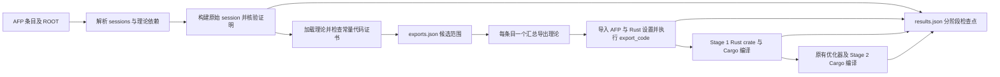

# AFP Isabelle2025 全量 Rust 导出实验报告

本报告对应独立的一次全量重跑；运行身份、源代码版本、命令及起止时间见 [run.json](run.json)。输入为完整 AFP 2025-03-17，含 893 个条目、922 个原始 session 和 9,122 个条目所属理论。统计来自本轮 [exports.json](../exports.json) 与 [results.json](../results.json)；用户所称的 result.json 在本工具中实际命名为 results.json。

## 计算流程与判定口径



1. `sessions.scala` 调用 Isabelle 的 session/dependency API 解析 AFP，而非按源文件关键词搜函数；记录条目拥有的理论、依赖 session 与 ROOT 中的编译器条件。扫描按依赖顺序执行，某个前置 session 失败后，其后继标为 blocked，其他独立条目继续。
2. `scan.py` 构建原 session，随后 `scan.ML` 从已加载的声明命名空间识别条目自身的常量，检查普通、抽象或投影代码方程；导入常量、缩写和没有代码方程的常量不进入候选。后续理论补充的方程通过合并上下文读取；独立分支冲突时分别读取最大上下文并记录冲突。证书异常仍保留候选和诊断。
3. `exports.json` 按“条目 → 相对理论路径 → 完整 HOL 常量名”保存范围。`run.py` 将同一条目的候选按全名去重，生成一个 `Entry_Rust_Export.thy` 及一个独立 ROOT session。非空条目只执行一次显式 `export_code ... in Rust`；依赖常量由 Isabelle 补齐。空范围不生成通配导出。
4. 汇总理论导入已加载的 AFP 理论和 `Rust.Rust_BigInt_Setup`。导入失败记为 theory_loading 失败并阻塞导出；进入 `export_code` 后失败才记为 rust_export 失败。生成 Rust crate 后以 Rust 1.94.0、锁定依赖执行 `cargo build --locked`。只有 Stage 1 编译通过才调用当前优化器并编译 Stage 2。
5. `results.json` 分别保存扫描、理论加载、Rust 导出、两次编译、优化和运行验证的状态、命令、耗时、退出码、最低可用内存、错误摘录及产物路径。编译成功只证明这些生成代码被该版本 Rust 接受；额外的 List-Index 有限输入测试提供独立的运行证据。

候选通过表示“至少收集到一个具有代码方程的条目自身常量”，不保证依赖可导出或 Rust 可编译。完整扫描后为空是 no_candidates；未加载完整则不能断言无候选。blocked 表示前置条件未满足，not_run 表示未执行，均不等同于实际执行失败。汇总导出采取整条目一次性导出，因此一个不支持的依赖就可能使整条目失败，结果不能解释为该条目所有函数都无法单独导出。

## 环境与复现

证明核验保持开启（`skip_proofs=false`），未修改 Rust 翻译器、优化器或 AFP 原始文件。本轮清空旧的 exports/results 记录，保留现有 Isabelle heap 缓存；这是对当前配置的重跑，不能用耗时代表冷启动、所有证明从头重建的成本。缓存通过 Isabelle 自身的有效性检查，已启用的条件理论按扫描器策略刷新 session。

开始独立新批次前须先备份并移开旧 `exports.json`、`results.json`；普通续跑会保留已有候选。本轮从空结果记录开始，依次执行：

```bash
python3 -B test/afp-Isabelle2025/scan.py --timeout 600
python3 -B test/afp-Isabelle2025/run.py --stage2 --timeout 180
python3 -B test/afp-Isabelle2025/run.py --entries List-Index --stage2 --timeout 180 \
  --runtime-command 'python3 -B test/afp-Isabelle2025/check_runtime.py {entry} {stage1} {stage2}'
```

Isabelle job/thread、Cargo job 均为 1，`parallel_proofs=0`；ML heap 上限 3,000 MiB，Java heap 768 MiB。扫描单命令限时 600 秒，导出/编译/优化限时 180 秒；Linux MemAvailable 低于 512 MiB 时终止该命令。超时、内存限制和未配置的 ROOT 条件都保留为实际结果，不通过删候选提高成功率。

本轮源代码为 `6f0a58d367f4cd192c920962da14c1f1e253b40e`，RustLightAST 为 `897fec3808d9053337e9cea54ff77b3a7e1d3e60`；具体输入文件哈希见 [inputs.json](inputs.json)。运行环境为 WSL Ubuntu-26.04，Python 3.14.4、Rust/Cargo 1.94.0；WSL 配额约 7.60 GiB 内存、2 GiB swap。

## 本轮结果

运行身份：`20261020T074609Z`。开始于 2026-10-20 07:46:09 UTC，结束于 2026-10-20 13:04:55 UTC（北京时间 15:46:09 至 21:04:55）。

| 命令批次 | 耗时 | 退出码 |
| --- | ---: | ---: |
| scan | 3 小时 52 分 55 秒 | 1 |
| export_compile | 1 小时 25 分 27 秒 | 1 |
| runtime | 0 小时 0 分 22 秒 | 0 |

扫描和全量运行的退出码 1 表示所选条目中仍有失败或未完成项；两个批次都已遍历全部 893 个条目。运行测试批次为随后对 List-Index 的重导出、两次编译和独立运行验证。

### exports.json：收集到哪些入口

实际检查了 **3,515/9,122** 个所属理论（38.53%）；2,189 个理论的候选列表非空。列表中共有 **40,426** 次常量引用，按条目去重后合计 40,426，全局按完整 HOL 常量名去重后为 **39,100**。同名的跨条目引用在全局覆盖统计中只计一次，这也不是语义上不同函数的数量证明。

| 候选范围类别 | 条目数 | 解读 |
| --- | ---: | --- |
| 完整扫描且非空 | 400 | 已得到可尝试导出的入口集 |
| 完整扫描且为空 | 38 | 确认 no_candidates |
| 扫描不完整但已收集部分候选 | 2 | 保留已发现入口，不能称为完整覆盖 |
| 扫描不完整且当前为空 | 453 | 候选数量未知，不能当成零候选成功 |

合计 893 个条目，其中 402 个候选范围非空。候选最多的十个条目如下，完整条目列表见 [entries.csv](entries.csv)。

| 条目 | 候选数（条目内去重） | 扫描 | 导出 | Stage 1 编译 |
| --- | ---: | --- | --- | --- |
| Isabelle_DOF | 2,310 | passed | failed | not_run |
| Safe_OCL | 937 | passed | failed | not_run |
| Security_Protocol_Refinement | 907 | passed | blocked | not_run |
| Universal_Turing_Machine | 686 | passed | failed | not_run |
| Generic_Deriving | 668 | passed | failed | not_run |
| Auto2_Imperative_HOL | 627 | passed | failed | not_run |
| Simpl | 626 | passed | failed | not_run |
| Key_Agreement_Strong_Adversaries | 591 | passed | failed | not_run |
| Consensus_Refined | 584 | passed | blocked | not_run |
| UPF_Firewall | 546 | passed | failed | not_run |

### results.json：这些入口实际走到哪一步

| 阶段 | passed | failed | timeout | memory_limit | blocked | no_candidates | not_run |
| --- | ---: | ---: | ---: | ---: | ---: | ---: | ---: |
| 候选扫描 | 438 | 18 | 0 | 0 | 437 | 0 | 0 |
| Rust 导出 | 41 | 350 | 2 | 0 | 462 | 38 | 0 |
| Stage 1 编译 | 26 | 15 | 0 | 0 | 0 | 0 | 852 |
| 优化 | 26 | 0 | 0 | 0 | 0 | 0 | 867 |
| Stage 2 编译 | 26 | 0 | 0 | 0 | 0 | 0 | 867 |
| 独立运行测试 | 1 | 0 | 0 | 0 | 0 | 0 | 892 |

每行分母都是 893；扫描行的 failed 包含未完成的会话、检查或条件理论，具体资源原因见下文。blocked 和 not_run 没有计入实际执行失败。

实际进入导出的 393 个条目中，41 个成功（10.43%）；得到 Rust crate 的 41 个条目中，26 个通过 Stage 1 编译（63.41%）。26 个条目通过优化及 Stage 2 编译，占全体条目的 2.91%。两次编译分别覆盖 153 和 153 个不同名称的候选；相对于本轮收集到的 39,100 个候选，Stage 1 编译覆盖比例为 0.39%。这是整条目入口集通过后累计的候选覆盖，不能解释为逐函数成功率。

最终条目状态：`blocked` 454，`failed` 375，`no_candidates` 38，`partial` 1，`passed` 25。

Stage 1 编译通过的条目：`Ackermanns_not_PR`、`Aristotles_Assertoric_Syllogistic`、`Birkhoff_Finite_Distributive_Lattices`、`CubicalCategories`、`Discrete_Summation`、`Dynamic_Tables`、`Generalized_Cauchy_Davenport`、`Go`、`Karatsuba_Sqrt`、`LatticeProperties`、`List-Index`、`List_Interleaving`、`Localization_Ring`、`Min_Max_Least_Greatest`、`Nominal_Myhill_Nerode`、`Parallel_Shear_Sort`、`Relation_Algebra`、`Skew_Heap`、`Splay_Tree`、`Stalnaker_Logic`、`Stellar_Quorums`、`Sunflowers`、`Szpilrajn`、`Transitive-Closure-II`、`Transitive_Union_Closed_Families`、`VectorSpace`。

Stage 1 实际编译失败的条目：`Approximation_Algorithms`、`Binomial-Queues`、`Digit_Expansions`、`FeatherweightJava`、`Gray_Codes`、`Latin_Square`、`List_Inversions`、`Max-Card-Matching`、`Nano_JSON`、`Pairing_Heap`、`Sauer_Shelah_Lemma`、`Sturm_Sequences`、`TortoiseHare`、`Trie`、`Vickrey_Clarke_Groves`。

Go 的两个候选通过两次编译，但四个条件理论需要尚未配置的 `ISABELLE_GOEXE`，因此最终为 partial；不能将编译通过与条目完整扫描混为一谈。

### 失败和覆盖缺口

扫描诊断中，14 个条目有超时记录，1 个有内存限制记录，1 个有未配置条件导致的缺失理论（类别可重叠）。HOL-Analysis 的准备构建在 600 秒内未完成，直接记录于 Akra_Bazzi 的扫描命令；434 个后续条目因该前置会话而阻塞。Posix-Lexing 则触发 512 MiB 可用内存保护；本轮最低观测值为 441 MiB。上述条目未获得完整理论上下文，其覆盖缺口不能归因于 Rust 翻译本身。

14 个超时条目中，11 个在原会话构建阶段超时；Factored_Transition_System_Bounding、Isabelle_Meta_Model、RSAPSS 三个在候选检查阶段超时。另两项 Catoids、OmegaCatoidsQuantales 的检查进程报告 `Unable to increase stack` 和 `Interrupt_Breakdown`。扫描不完整但已收集候选的两个条目是 Flyspeck-Tame（243 个）和 Go（2 个）。

462 个导出 blocked 中，449 个来自已知 AFP 会话加载失败，5 个来自候选扫描不完整，8 个在汇总 AFP 导入或 Rust 设置加载时失败；这些均未成功进入导出。

ROOT 条件的清单如下。“未配置”指 Isabelle 对应环境变量为空，不据此推断系统完全没有该编译器；清单是源配置中的理论数量，不代表这些理论都已实际尝试加载。变量原值见 [compiler-conditions.json](compiler-conditions.json)。

| ROOT 条件 | 涉及理论数 | 当前配置 |
| --- | ---: | --- |
| ISABELLE_CAKEML_HOME | 2 | 未配置 |
| ISABELLE_CC | 2 | 未配置 |
| ISABELLE_GHC | 5 | 已配置 |
| ISABELLE_GOEXE | 4 | 未配置 |
| ISABELLE_MLTON | 4 | 已配置 |
| ISABELLE_OCAMLFIND | 21 | 未配置 |
| ISABELLE_SMLNJ | 2 | 未配置 |

发现阶段对互不兼容的独立理论分支可分别收集候选，但汇总导出仍须把它们同时导入；此外，自动生成的 Quickcheck narrowing 实例可能依赖没有 Rust 代码方程的支持函数。实际生成 Rust 后仍可能出现类型或 trait 约束错误。实验保留这些候选及失败，未通过过滤候选修饰通过率。

## 案例研究

同一成功条目可覆盖多个阶段的正例，下表同时给出三个阶段的正反例，并增加资源限制案例。所有路径均指向本次保存的证据，而非清理后失效的临时构建目录。

| 条目 | 候选 | Rust 导出 | Stage 1 编译 | Stage 2 编译 | 用途 |
| --- | --- | --- | --- | --- | --- |
| [List-Index](cases/List-Index/) | 通过，6 个 | 成功 | 成功 | 成功 | 三个阶段的正例 |
| [Example-Submission](cases/Example-Submission/) | 完整扫描，0 个 | no_candidates | 未执行 | 未执行 | 无可执行候选的反例 |
| [AVL-Trees](cases/AVL-Trees/) | 通过，80 个 | 失败 | 未执行 | 未执行 | 有候选但无法导出 |
| [Approximation_Algorithms](cases/Approximation_Algorithms/) | 通过，5 个 | 成功 | 失败 | 未执行 | 有 Rust 产物但不能编译 |
| [Posix-Lexing](cases/Posix-Lexing/) | 扫描未完成，未知 | blocked | 未执行 | 未执行 | 资源失败不能当成零候选 |

### List-Index：从可执行定义到可编译 Rust

原始 [List_Index.thy](cases/List-Index/original/List_Index.thy) 定义 `find_index`、`index`、`last_index`、`insert_nth`、`map_index`、`remove_nth` 六个候选。例如 `find_index P [] = 0`，对非空列表检查首元素，命中返回 0，否则递归结果加 1；未命中返回列表长度。[候选范围](cases/List-Index/scope.json) 与 [汇总导出理论](cases/List-Index/export/List-Index_Rust_Export.thy) 可逐项对照。

Stage 1 的 [List_Index.rs](cases/List-Index/rust-before/export1/src/List_Index.rs) 将列表译为 `List::Nil/Cons` 和 `match`，自然数映射到 `BigInt`，函数参数用 `Rc<dyn Fn(...)>`；`index` 保留柯里化结构，返回闭包。Stage 2 的 [对应文件](cases/List-Index/rust-after/export1/src/List_Index.rs) 在当前优化器下减少 clone，并把 `insert_nth` 的数字参数变为 `&BigInt`、`last_index` 的列表参数变为 `&List<A>`。两份完整 crate、Cargo.toml、Cargo.lock 均保留；编译日志分别为 [Stage 1](cases/List-Index/logs/stage1-1.compile.txt) 和 [Stage 2](cases/List-Index/logs/stage2-1.compile.txt)。

独立 [运行测试](../runtime/list_index.rs) 枚举长度 0..5 的全部 63 个布尔列表，用 Rust Vec 和直接索引计算作为 oracle，覆盖首次/末次查找、空列表、越界插入/删除及带索引映射。每阶段 2,166 个断言，总计 4,332；详见 [Stage 1 日志](cases/List-Index/logs/stage1.runtime.txt)、[Stage 2 日志](cases/List-Index/logs/stage2.runtime.txt)。这只覆盖这六个入口和这些有限输入，不代表其他已编译条目通过语义验证。

### Example-Submission：理论通过，候选为空

原始 [Submission.thy](cases/Example-Submission/original/Submission.thy) 主要是提交格式说明及 `true`、`very_true` 两个 `True` 的证明，没有条目自身的可执行函数常量。会话加载及扫描均成功，[scope.json](cases/Example-Submission/scope.json) 中 `Submission.thy` 对应空列表。生成的 [汇总理论](cases/Example-Submission/export/Example-Submission_Rust_Export.thy) 明确不发出 `export_code`，因此没有 Rust crate，也没有 Cargo 编译失败。这里的“候选不通过”应读作无可执行候选，不是 Isabelle 证明错误。

候选筛选还会区分缩写与真正定义：Approximation_Algorithms 的 [Approx_LB_Hoare.thy](cases/Approximation_Algorithms/original/Approx_LB_Hoare.thy) 中 `Max\<^sub>0` 是 abbreviation，不进入候选；递归函数 `f_Max\<^sub>0` 则进入候选。

### AVL-Trees：候选有方程，传递依赖仍会阻止导出

原始 [AVL.thy](cases/AVL-Trees/original/AVL.thy) 和 [AVL2.thy](cases/AVL-Trees/original/AVL2.thy) 包含树类型、平衡检查及插入/删除等定义。扫描完整通过并收集 80 个候选，也包含数据类型自动产生的 Quickcheck narrowing 实例。[汇总理论](cases/AVL-Trees/export/AVL-Trees_Rust_Export.thy) 对这些入口执行一次导出。

[实际导出日志](cases/AVL-Trees/logs/export.txt) 在 `export_code` 处报告：

```text
No code equations for ??.Quickcheck_Narrowing.toEnum,
??.Quickcheck_Narrowing.marker, ??.Quickcheck_Narrowing.error,
??.Quickcheck_Narrowing.nth
narrowing [AVL.tree] -> narrowing [nat] -> Quickcheck_Narrowing.apply
  -> ??.Quickcheck_Narrowing.conv -> ??.Quickcheck_Narrowing.toEnum
```

候选自身有代码方程，不保证所有传递依赖对 Rust 都有实现。当前范围包含这些自动实例，因而整条目导出失败；80 个候选仍保留，未删去困难入口。这个案例没有生成 Rust crate，不能把随后未执行的 Cargo 记为编译失败。原始理论、显式导出命令、原始扫描 XML、完整日志及 [分阶段记录](cases/AVL-Trees/result.json) 均已保存。

### Approximation_Algorithms：导出成功，类型类约束导致编译失败

原条目六个理论中共收集五个候选。以 [Approx_LB_Hoare.thy](cases/Approximation_Algorithms/original/Approx_LB_Hoare.thy) 的 `f_Max\<^sub>0` 为例：`f_Max\<^sub>0 f 0 = 0`，后继情况计算 `max (f (Suc x)) (f_Max\<^sub>0 f x)`。原始证明和扫描通过，[汇总导出](cases/Approximation_Algorithms/export/Approximation_Algorithms_Rust_Export.thy) 成功写出完整 Rust crate。

在 [Approx_LB_Hoare.rs](cases/Approximation_Algorithms/rust-before/export1/src/Approx_LB_Hoare.rs) 中，该函数成为以 `BigInt` 表示自然数的 `f__max_0`，并调用 [Orderings.rs](cases/Approximation_Algorithms/rust-before/export1/src/Orderings.rs) 的泛型 `max<A: Clone + Ord + 'static>`。Rust 编译器在前者第 14 行报 `E0277`：

```text
the trait bound `num_bigint::BigInt: Orderings::Ord` is not satisfied
BigInt implements std::cmp::Ord, but not Orderings::Ord
```

完整 [Cargo 日志](cases/Approximation_Algorithms/logs/stage1-1.compile.txt) 显示，当前生成代码要求的是导出模块自己的 `Orderings::Ord`；标准库的同名 trait 并不能满足该约束。这是“生成成功”和“能编译”之间的具体缺口。本轮只记录实验结果，未补实例或修改翻译规则。Stage 1 失败后优化及 Stage 2 未执行，因此没有相应 Stage 2 产物。

### Posix-Lexing：内存保护停止构建，候选数量未知

保存了原条目的 [ROOT](cases/Posix-Lexing/original/ROOT) 及十个原始理论，包括 [Lexer.thy](cases/Posix-Lexing/original/Lexer.thy) 和 Extensions 子目录。尝试构建 `Posix-Lexing` session 时，内存保护在 105.13 秒后终止进程，记录到的最低 MemAvailable 为 441 MiB，状态为 `memory_limit`、退出码为 -15，详见 [结果记录](cases/Posix-Lexing/result.json) 及 [构建日志](cases/Posix-Lexing/logs/Posix-Lexing.load.txt)。

尚未获得成功加载的会话，因此本轮候选范围虽然存为空对象，也不能推断该条目没有可执行定义。后续导出状态为 blocked，没有 Rust crate 或编译结论。它与 Example-Submission 的“完整扫描后为空”有不同含义。

## 保留证据与复查

[cases/](cases/) 保存五个案例的原条目 ROOT、全部所属 `.thy`、来源和 SHA256、本轮候选范围、结果快照、生成的汇总导出理论、可用的扫描 XML、完整命令日志，以及实际生成的优化前/后 Rust 源码 crate。原始 AFP 作者注释保留，许可证见 [AFP-LICENSE](cases/AFP-LICENSE)。没有为失败或未执行的阶段制造产物。案例源码仍依赖上文指定的完整 AFP 和本项目版本。

[entries.csv](entries.csv) 为全部 893 个条目提供一行结果，便于筛选候选数量、各阶段状态、缺失条件和诊断；[summary.json](summary.json) 提供对应汇总值，[batch-logs/](batch-logs/) 保留三次命令的完整遍历输出。每个案例的 `scope.json` 和 `result.json` 是主 JSON 中该条目的快照。

保留目录采用 `rust-before/` 和 `rust-after/`，不会被 `make clean` 的 `stage1/stage2` 清理规则删除。完成快照及核验后已运行 `make clean`，移除普通构建目录及本轮 `_build`；原始 `results.json` 的 artifacts 路径记录当时执行位置，`preserved_evidence` 指向持久副本。案例保留目录不含 target、二进制或编译缓存。

可从仓库根目录直接编译保留的成功 crate，或复现失败诊断：

```bash
cargo +1.94.0 build --locked --manifest-path \
  test/afp-Isabelle2025/report/cases/List-Index/rust-before/export1/Cargo.toml
cargo +1.94.0 build --locked --manifest-path \
  test/afp-Isabelle2025/report/cases/List-Index/rust-after/export1/Cargo.toml
cargo +1.94.0 build --locked --manifest-path \
  test/afp-Isabelle2025/report/cases/Approximation_Algorithms/rust-before/export1/Cargo.toml
```

最后一条预期重现 `E0277`。若只读检查，可在 `test/afp-Isabelle2025/report/` 下执行 `sha256sum --quiet -c SHA256SUMS` 校验保留证据。文件的上游空白与换行作为原始证据保留，`.gitattributes` 禁止对其自动换行转换。

复核已通过 21 项工具回归检查，并核验所有条目和候选范围、分阶段前置关系、命令时间属于本次运行、893 个生成理论及 ROOT 会话、原 ROOT 其余内容未变、案例源文件及 Rust 副本字节一致。详情见 [validation.json](validation.json)。本轮不修改 Rust 后端或优化器。
